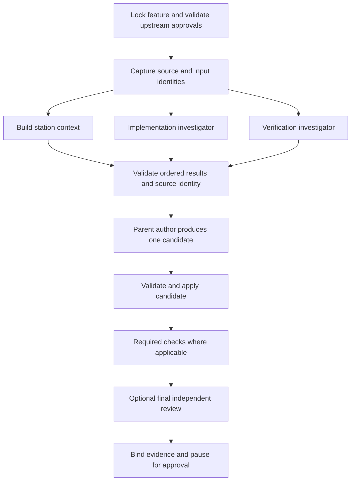

# Plan: optimize execution within each Kitchen station

Prepared 2026-11-05 against commit `f2b67b774eeedfff08e5f65551a62df972e2f423`.
Status: source analysis and offline scheduling experiments completed; production
changes proposed below are not implemented. The accompanying benchmark is new.

## Recommended direction

Keep the eight station approvals in order. Optimize the work inside each station
with a bounded task graph, source-bound context reuse, and runner-managed child
agents that return structured results to one parent. Start with improvements to
existing discovery and check scheduling before adding parallel code authors.

The first implementation should overlap context construction with plan discovery,
reuse a verified repository inventory within one read phase, and improve timing
attribution. Then introduce opt-in specialist investigations for spec, test-plan
and verify. Parallel file proposals belong in a later phase with explicit file
ownership and a deterministic parent join.

This plan preserves before/after mutation detection, detached baseline RED,
accepted test integrity, evidence-aware final review, and exact publication
approval. There are no measured production-model speedup or quality claims.

## Tests executed before selecting this plan

The new [offline benchmark](../../scripts/benchmark-stations.ts) calls production
`discover`, `executeChecks`, `buildContext`, `evidenceBundle`, and `sourceSnapshot`.
It uses a disposable Git fixture, five repetitions, and alternating scenario
order. Discovery providers are in-process fixtures with 70/110 ms delays; command
checks are real Node subprocesses with a 180 ms workload. No model CLI, dependency
installation, hosted inference, push, or PR is invoked by the benchmark.

Raw samples and assertions are retained locally in
`.kitchen/benchmarks/station-optimization-154ecb44-e45b-42a2-8985-3cfb34369aa9/report.json`.

| Hypothesis | Comparison, median of five | Result and interpretation |
| --- | --- | --- |
| Independent discovery can overlap | Serial 212.4 ms; concurrent 130.5 ms | 38.6% less elapsed time, 1.63x. Both still make two provider calls. This confirms the existing scheduler with simulated inference. |
| Independent checks benefit from the existing two slots | Four serial commands 1,087.8 ms; independent commands 569.6 ms | 47.6% less elapsed time, 1.91x, with all four statuses and declared result order preserved. |
| Shared resources must remain serialized | Shared-resource commands 1,090.0 ms | Observed maximum concurrency one. Changing labels alone cannot establish independence. |
| An exclusive check constrains the critical path | Two parallel commands, an exclusive command, then another: 822.7 ms | Earlier checks finished before the barrier; later work waited for it. |
| Context construction can overlap plan discovery | Current sequential composition 379.5 ms; concurrent prototype composition 258.4 ms | 31.9% less elapsed time, 1.47x. Context text, ordered discovery results and source identity matched. This composes existing functions; `Kitchen.callProvider` itself is unchanged. |
| Evidence-cache hits substantially reduce local work | Cold bundle 100.5 ms; verified hit 103.0 ms | No observed time saving. Source inspection explains why: the bundle is reconstructed before the cache is consulted. |
| Whole-source scans have measurable fixed cost | Actual checkout: 104 files, 860,029 bytes; median 138.3 ms, range 136.9–299.4 ms | Repeated scans matter for short stations. This does not justify dropping guards around external execution. |

The benchmark also asserted source-citation hashes, no discovery mutations,
zero extra provider calls on valid discovery-cache hits, local-provider
serialization, and invalidation after a selected source edit even when supplied
the same code key. Timing thresholds are not used as correctness assertions.

Focused regression results: **44 passed, 1 failed** across four files: discovery
15/15, check scheduling 5/5, hosted adapters with fake executables 24/24, and
evidence-bundle 0/1. Report:
`.kitchen/validation/station-optimization-focused.json`.

The evidence-bundle failure predates this change. The existing test expects a
source hash for `apps/desktop/src/brand.tsx.` mentioned at a sentence end.
`mentionedPaths` returns the trailing period as part of the filename, so exact
inventory matching omits the source excerpt. A direct reproduction confirmed
that extraction with and without the period differs. Fix and qualify that
boundary before expanding evidence caching; see
[the extractor](../../src/evidence-bundle.ts:15) and
[the regression](../../test/evidence-bundle.test.ts:37).

The initial full sandbox run finished with 331 passed and 68 failed out of 399.
Failures included Windows restrictions on Git's local transport, symlinks,
process termination and loopback servers, plus the evidence-bundle failure and
Node 26's `DEP0205` warning breaking an empty-stderr assertion. A protected
out-of-sandbox rerun used process-local `GIT_ALLOW_PROTOCOL=file` to prohibit Git
network transport and suppressed only `DEP0205`: **398 passed, 1 failed out of
399**, across 27 test files. The sole remaining failure was the same
evidence-bundle regression. The complete JSON report is retained at
`.kitchen/validation/station-optimization-tests.json`. These are separate runs,
not a combined pass count.

Repository type checking and lint passed before the experiments. Final lint also
passed, and the new benchmark passed a separate strict TypeScript check because
the repository tsconfig excludes scripts.
Five repetitions establish feasibility for these fixtures; they do not establish
tail latency, provider throughput, token savings, or generated-code quality.

One actual child agent independently inspected adapters and concurrency
boundaries and returned its findings to the parent during this investigation.
That verifies delegation in this session. The production feasibility evidence
comes from Kitchen's own discovery implementation and executed fixture tests.

## Current algorithm and execution flows

The coordinating implementation is [Kitchen](../../src/kitchen.ts:583). A normal
execution station follows this sequence:

1. Acquire the per-feature lock, refresh approval fingerprints, require all
   earlier approvals, and validate preparation where applicable.
2. Save a new run and invalidate downstream approvals. Resume saved questions
   first; non-interactive runs with no answers return without a provider call.
3. For unit-tests, preflight dependency setup before authoring.
4. Snapshot all eligible source, build station context, optionally run plan
   discovery, call the author, then re-snapshot and verify no external mutation.
5. Resolve questions before applying any bundled candidate. An interactive run
   can make one further author call after answers; remaining questions pause.
6. Validate the complete proposal, then write the document or allowed files.
   Run detached-baseline checks for unit-tests, or GREEN checks for
   implementation and verify. Verify renders its report after checks.
7. Run independent review if enabled. Review currently sees executed check
   evidence; verify regenerates its report when review adds findings.
8. Compute the approval fingerprint, save evidence, and pause for a human.
   Approval is a separate locked operation that revalidates the fingerprint.

Publish has its own path: candidate/base/scope/test-integrity checks → exact
preview → optional review → human approval → identity and remote-base checks →
commit → final fingerprint check → push → find/create the recoverable draft PR.
Its author is not called. Publication side effects remain ordered.

| Mechanism | Existing behavior and consequence |
| --- | --- |
| Source identity | [sourceSnapshot](../../src/git.ts:42) inventories tracked and untracked eligible files, sorts paths and hashes all bytes. Approximate cost is `O(N log N + B)`, plus Git startup. It derives full and code-only identities in one scan. |
| Approval refresh | [refresh](../../src/kitchen.ts:255) walks at most eight station records in order and shares a source fingerprint for applicable approved execution stations. Staleness propagates downstream. Parallel refresh of dependent records is inappropriate. |
| Context | [buildContext](../../src/context.ts:33) reads authoritative documents and instructions, builds a bounded evidence bundle, then obtains diff and untracked paths for applicable stations. The full diff is not bounded by the 24 KiB evidence-bundle limit. |
| Discovery | [discover](../../src/discovery.ts:65) already fans out implementation and verification investigations, validates/hashes citations, joins in declared order and persists a verified cache. Hosted providers use two concurrent requests; DeepSeek uses one at a time. It is opt-in and invoked before the plan author. |
| Check setup | [executeChecks](../../src/checks.ts:592) deduplicates setup identities and completes dependency writes before launching checks. [executeSetup](../../src/setup-runner.ts:181) also locks installs per worktree and validates its cache. |
| Check scheduling | Two slots, explicit `parallelSafe`, canonical cwd/resource groups, shared-fixture exclusion, and exclusive browser/manual/unopted checks. Pending scans can approach quadratic work in check count; this is a secondary concern for small manifests. |
| Check evidence | Each completion scans the run directory for its evidence files. With many checks, repeated directory scans and hashing add avoidable work. Child-specific directories or an explicit artifact list could bound this cost. |
| Provider capabilities | [providerInvocation](../../src/providers.ts:209) disables native Codex `multi_agent`; Claude exposes Read/Glob/Grep. DeepSeek's tool guard permits reads. Kitchen, rather than the provider, owns writes and execution. |
| Timing | Execution stations record phase, provider, prompt, human-wait and snapshot data. [readTimings](../../src/timings.ts:41) distinguishes summed provider work from interval-union elapsed time. Publish lacks the equivalent complete run-metrics wrapper; provider/check queue time and child identity are not explicit. |

The largest theoretical gains come from replacing sums of independent durations
with their maximum. For two child tasks of duration `A` and `B`, a join costs
approximately `max(A,B) + scheduling/join overhead`, rather than `A+B`. Extra
workers still increase total inference work and may lengthen a shared local
model's queue. No experiment here establishes that more than two workers helps.

## Optimization plan for each station

| Station | Present critical path | Proposed optimization | Parent join and limits |
| --- | --- | --- | --- |
| Foundation / doctor / start | Doctor already overlaps inventory and CLI diagnostics but runs structured model probes serially. Start creates an isolated worktree and state. | Bound diagnostic fan-out; group probe jobs by executable, provider endpoint and model resource. Overlap independent hosted probes after prerequisites. Reuse one immutable config/instruction inventory per operation. | Keep local model probes serial by default, preserve separate response-contract checks and cancellation, and serialize shared Git metadata mutations. Benchmark doctor separately before changing it. |
| intent | Minimal instructions/template → author/questions → lint → optional review. It already avoids broad implementation context. | Keep a single author by default. Batch related questions and reuse verified continuation where the existing session policy permits. Generate a concise review view from the candidate and questions. | Never infer human answers. Parallel agents add requests and synthesis overhead to a small station; enable only for unusually large, clearly partitioned stakeholder analysis. |
| spec | Accepted intent and evidence → author → AC/heading validation → optional review. | For complex requests, run business-rule/permission analysis and failure/example analysis on the same accepted intent in parallel; parent synthesizes one spec. | Parent owns stable AC IDs, reconciles contradictions and surfaces product questions. Investigators cannot silently choose unresolved product behavior. Single-author default remains. |
| plan | Context → optional two-agent discovery → author → exact scope manifest → optional review. | First overlap context construction and the existing discovery pair. Start both after one source snapshot; join before the author. Reuse verified discovery on unchanged inputs. | Require both results, citation validation, the post-discovery full-source guard and exact accepted scope. Prototype passed; production cancellation/metrics integration still needs tests. |
| test-plan | Accepted spec/plan → author → normalized IDs, scope and coverage validation → optional review. | Parallel investigators map disjoint AC groups or packages to tests and inspect runtime/profile prerequisites. Parent composes one coverage matrix and manifest. | Detect missing/duplicate AC mappings, normalized check-ID collisions and incompatible profiles. Shared test-file ownership prevents independent writers from producing conflicting content. |
| unit-tests | Setup preflight → author proposals → detached pinned baseline → setup/checks → optional review → tests-first approval commit. | Draft disjoint approved test files as parallel proposals after runtime preflight. Use existing independent check slots on the single prepared baseline. Deduplicate setup and candidate/baseline inventory reads within safe phases. | Freeze interface assumptions first. Parent validates every proposal before any write; retain throw-only scaffolds, pinned production baseline, per-AC assertion RED and preservation GREEN. Shared-file tests stay together. |
| implementation | Author → scoped writes → GREEN checks → optional review. | Partition the accepted file/dependency graph into independent components. Children propose complete changes for assigned files; parent joins and applies once. Begin with at most two hosted workers. | Shared interfaces and dependency order form explicit barriers. Reject overlapping paths, test rewrites and scope expansion. Run integrated GREEN after the join; isolated child success cannot replace it. |
| verify | Read-only author assessment → fresh required checks → verification report → optional review → reviewed report. | Use behavior/flow, architecture and test-integrity investigators. After a question-free parent assessment, overlap preliminary specialist analysis with eligible checks against a frozen candidate. | No checks start while author questions remain unresolved. A final evidence-aware synthesis/review waits for complete checks and the rendered report. Child opinions and cached GREEN are not final execution evidence. |
| publish | Candidate validation → exact preview/review → human approval → remote preflight → commit/push/PR. | Parallelize independent read-only local preflight queries and preview-analysis tasks; add full metrics and reuse an immutable preview representation. | Revalidate state after the read join. Keep exact-preview approval, identity, remote-base check, final source check, commit/push and PR recovery ordered. Keep independent review opt-in. |

## Parent and subagent orchestration

Extend the discovery pattern instead of enabling opaque provider-native spawning.
Today the parent receives a resolved `DiscoveryResult[]` and appends it to the
plan author's context. The same explicit request/structured-return pattern can
support other stations without allowing children to mutate shared state.

Proposed graph for planning:



1. **Typed task contracts.** Add task request/result schemas rather than passing
   file proposals through discovery's analysis-only schema. Each task carries
   `taskId`, `parentRunId`, station, task kind, dependencies, assigned paths,
   source/input/policy digests, provider identity, deadline and budgets. Results
   carry status, structured output, cited evidence, output hashes, assumptions,
   unresolved questions and attempt/timing/usage data. Treat unknown usage as
   unknown, not zero.
2. **One parent writer.** Children return analysis or file proposals. They never
   call `Kitchen.run`, acquire the parent feature lock, save `FeatureState`, run
   checks, approve, commit or publish. Calling `Kitchen.run` recursively would
   conflict with the existing lock. Only the parent commits the joined outcome.
3. **Bounded resources.** Start with two hosted tasks and one task per local
   endpoint/model resource. Add a global cap across features as well as a
   per-station cap. Model queue, memory pressure, CPU, fixture and install
   resources matter more than provider names alone. Depth one by default;
   workers cannot recursively fan out. New settings must be validated and
   fingerprinted before use; these are proposed options, not existing CLI flags.
4. **Deterministic join.** Persist results per task and attempt, then consume them
   in declared task order, independent of completion order. Validate response
   schemas, cited paths/lines/hashes, input identity, assigned ownership, allowed
   scope and accepted test hashes. Reject conflicting paths or assumptions;
   never apply a last-writer-wins merge. Route required unresolved decisions to
   the parent and operator before file application.
5. **Complete proposal validation.** Join proposals in memory and run all
   station-specific restrictions before calling the existing application path.
   Exact path disjointness is necessary but insufficient: shared interfaces,
   migrations and coupled behavior also create dependencies. Introduce staged
   scratch validation if stronger all-or-nothing filesystem writes are needed;
   current validation-before-write does not make I/O failures transactional.
6. **Failure and recovery.** Give each child a distinct evidence directory and
   shared parent cancellation. Abort siblings on required-task failure, settle
   all in-flight requests, retain partial evidence, and never cache incomplete
   joins. Retry only a failed child against unchanged full task inputs, within
   the parent deadline and attempt budget. Optional analysis may fall back to
   the existing single-author path with a visible record; required review or
   checks cannot be silently skipped. Verify provider children actually stopped
   before recovery writes.
7. **Reporting to the parent.** Return compact typed results through promises,
   persist full raw evidence, and pass summaries plus evidence references to
   synthesis. Extend `ProviderRequest`, `ProviderMetrics` and run metrics with
   parent/task/attempt linkage and queue/start/end/join times. Use unique span
   IDs so overlapping task events cannot collide. Persist progress centrally
   through the parent rather than competing state writers.

## Reduce redundant work without weakening source identity

Introduce a read-phase repository view containing validated file inventory,
digests, parsed config, instruction contents, authoritative document contents,
diff and untracked paths. Build multiple derived contexts from that view.
Discard it after provider execution, setup, checks, file application, or a human
pause. These boundaries allow externally observable changes, so a new scan is
required. Approval remains a fresh full validation boundary.

Move the evidence cache lookup before excerpt reconstruction only after its key
contains every input affecting the text. That includes the verified code
snapshot, accepted and edited candidate documents, instructions and referenced
documents, request and targets, test/package inventories, missing-file facts,
station, and context/prompt policy. Derive a compact cache identity from already
verified inputs and validate the stored payload. A supplied code string or
mtime-only cache is insufficient. Keep deleted/untracked files and symlink
retargeting in negative tests. Measure this separately from discovery caching,
which already avoids provider requests on verified hits.

Precompute immutable check resource keys once per execution batch and record
artifact paths directly. This reduces repeated path canonicalization and
directory scans while preserving cwd aliases, case rules, fixture exclusion,
setup-before-readers and exclusive barriers. Do not relax browser or manual
exclusivity as part of the initial optimization.

Later experiments may use AC-scoped context slices and one immutable browser
build per source/profile/build identity. Always preserve complete relevant
requirements, exact manifests, unresolved blockers and access to omitted source.
Do not truncate accepted contracts to achieve a byte target. Browser artifacts,
ports and fixture state need independent isolation before sharing builds.

Reuse of implementation GREEN as final verify evidence is deferred. Source
identity alone omits environment, commands/parsers, dependencies, fixtures,
tools and time-sensitive behavior. Consider it only for explicitly approved,
deterministic checks with complete provenance and a test-plan freshness policy;
the default continues to execute required verification checks.

## Delivery order and acceptance gates

| Step | Concrete change and likely files | Exit gate |
| --- | --- | --- |
| 0. Establish a trustworthy baseline | Correct sentence-ending path extraction in `src/evidence-bundle.ts`; expand punctuation/path tests. Preserve the existing Windows regression evidence. | Evidence-bundle regression passes; no legitimate dotted filenames, references or exclusions regress. Obtain a complete runnable regression result before rollout. |
| 1. Instrument the critical path | Extend `src/types.ts`, `src/metrics.ts`, `src/timings.ts`, `src/kitchen.ts` and `src/provider-progress.ts` for child identities, queue/join spans, source-scan counts, cache work and publish timings. | Failures, retries, human wait and cancelled/partial tasks remain visible; elapsed intervals are unioned and work is summed without double-counting nested phases. |
| 2. Optimize existing read and check paths | Overlap context/discovery in `src/kitchen.ts`; add a read-phase view across `src/git.ts`, `src/context.ts`, `src/evidence-bundle.ts` and `src/prompts.ts`; precompute resources in `src/checks.ts`. | Context/output equivalence, post-external-call guards, cancellation and cache invalidation pass. Reproduce the benchmark gains without changing approvals or check outcomes. |
| 3. Add bounded analysis tasks | Extract reusable task scheduling from `src/discovery.ts` into a small runner module, add task contracts in `src/types.ts`/`src/providers.ts`, validate opt-in settings in `src/config.ts`, and integrate spec/test-plan/verify. | Single-author default works unchanged. Required failure/cancellation never approves. Known review blockers are detected and unresolved decisions reach the parent. |
| 4. Pilot parallel proposals | Add dependency-aware partitioning and parent proposal joins for unit-tests, then implementation; update prompts and fixtures. | Duplicate/conflicting path, stale input, scope, scaffold and test-rewrite attacks fail before writes. Detached RED and integrated GREEN remain authoritative. |
| 5. Qualify and roll out | Extend the benchmark matrix and station reports; document resource limits and rollback in README/config examples. | Paired live runs meet the quality/cost gates below, first at concurrency two; local concurrency remains one until independently qualified. |

Use an opt-in setting for new task modes and retain the single-author fallback.
Fingerprint task topology, schemas, prompts, effective providers, budgets and
cache policy so changing the orchestration invalidates old candidates as
appropriate. Existing on-disk state needs a compatible reader or an explicit
version migration; do not require a workflow engine, queue service or daemon.

## Qualification matrix

Run correctness first, then compare elapsed time and total work for the same
requests, commits, provider/model settings, review policy and check manifests.
Include simple requests where delegation should stay off, a multi-package
feature with disjoint files, a shared-interface feature, and a failure-heavy
feature with operator questions and retries. Local-model qualification is a
separate experiment; existing model completion/idle-timeout problems must be
resolved before inferring any benefit from local concurrency.

- Unit and integration tests: task dependency/order, bounded and global limits,
  shared resources, install barriers, deterministic joins and collision handling.
- Negative tests: malformed/partial output, source edits during a task,
  instruction or config changes, cancelled cache hits, sibling abort, stale
  child retries, unknown evidence, path escapes, symlink changes, duplicate
  check IDs and attempts to rewrite accepted tests.
- Workflow tests: question-only pauses, no candidate application with unresolved
  questions, no skipped approvals, detached assertion RED, tests-first commit,
  integrated GREEN, final reviewer seeing complete check evidence, exact publish
  preview and recoverable PR side effects.
- Metrics: median and tail active time per station; human wait separately;
  provider work and elapsed intervals; queue/join time; prompts, tokens and
  cost where available; calls and attempts per successful station; invalid JSON,
  incomplete generation and all unsuccessful tasks. Do not drop failed cases.
- Proposed rollout gates: no loss of required coverage or known blocker
  detection, no increase in contract failures or retries, at least 15% lower
  median active time on the eligible multi-file workload, and no more than 10%
  extra total inference work/cost unless explicitly accepted. These are targets,
  not results; more than five repetitions are needed for reliable tail estimates.

Reproduce the offline experiments with:

```powershell
pnpm exec tsx scripts/benchmark-stations.ts --iterations 5
pnpm check:types
pnpm lint
pnpm exec vitest run test/discovery.test.ts test/check-runner.test.ts test/hosted-adapters.test.ts test/evidence-bundle.test.ts
```

Run the regression tests in an environment that permits their disposable local
Git transports, loopback servers, symlinks and process-tree cleanup. No real
provider or GitHub account is needed for these regression fixtures.
