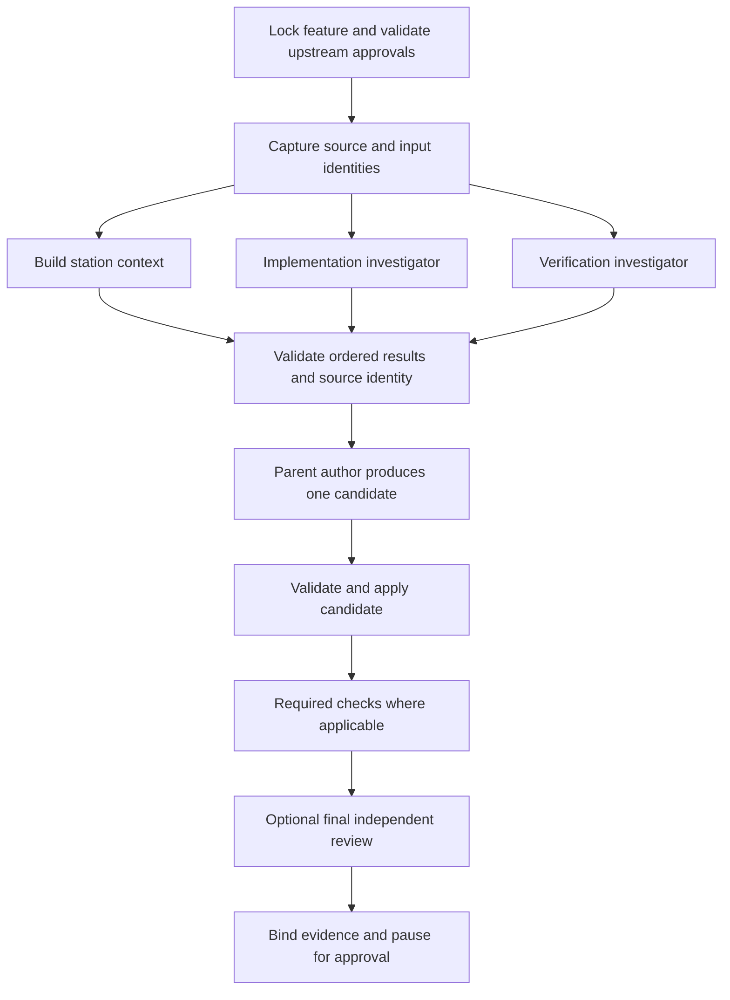

# Plan: optimize execution within each Kitchen station

Prepared 2026-11-05 against `f2b67b7`; re-audited and benchmarked 2026-11-12
against `4c8b671`. Status: proposal. No runner behavior was changed in the
re-audit. The eight stations are defined in [station order](../../src/domain.ts:6)
and enforced by [upstream approval checks](../../src/kitchen.ts:323).

## Recommended direction

Keep the eight station approvals in order. Optimize the work inside each station
with a bounded task graph, source-bound context reuse, and runner-managed child
agents that return structured results to one parent. Start with improvements to
existing discovery and check scheduling before adding parallel code authors.

First, attribute elapsed time to the actual critical path, overlap context with
already-enabled plan discovery, and make the existing two check slots safe and
useful for more eligible profiles. Reuse a verified repository inventory within
one read phase. Use measured station times to decide whether to pilot specialist
investigations. Parallel file proposals belong in a later phase with explicit
file ownership and a deterministic parent join.

This plan preserves before/after mutation detection, detached baseline RED,
accepted test integrity, evidence-aware final review, and exact publication
approval. There are no measured production-model speedup or quality claims.

## Current evidence (2026-11-12)

The [offline benchmark](../../scripts/benchmark-stations.ts) passed its
assertions on seven paired iterations against the clean `4c8b671` checkout.
It uses simulated provider delays and real Node check subprocesses, with no
model calls, installs, or publication. Raw data is in the ignored local report
`.kitchen/benchmarks/station-optimization-9bb4474c-4387-4660-bdb9-ee471184710f/report.json`.

| Measured operation | Before → after (median) | What it supports |
| --- | --- | --- |
| Discovery pair, serial → concurrent | 218 → 131 ms (40% less) | Existing hosted scheduling policy; verified warm hits took 16 ms and made no provider calls. |
| Four command checks, serial → independent profiles | 1,046 → 556 ms (47% less) | Existing two-slot runner; a shared resource took 1,079 ms and an exclusive barrier took 807 ms. |
| Plan context plus discovery, serial → prototype overlap | 359 → 225 ms (37% less) | Overlapping the two branches on a shared source identity; excludes author time and does not measure a whole station. |
| Evidence bundle, cold → verified hit | 91 → 91 ms | Cache lookup occurs after the bundle has been rebuilt. |
| Full snapshot of this checkout | 145 ms (139 files, 1,051,235 bytes) | Inventory reuse can help short runs; continue to scan across mutation boundaries. |

The earlier local timing capture contains 35 measured runs across intent,
spec, plan, and test-plan, including failures. Provider elapsed intervals account
for 99.76% of recorded active time in aggregate (99.61–99.89% by station).
This is one historical workload, not a current Kindi measurement or evidence
for the other four stations. It makes provider completion, retries, and prompt
work the first things to measure for local authoring; file scans alone will not
materially reduce minutes of generation.

All 15 discovery tests and all 3 evidence-bundle tests passed. The four
check-runner cases runnable in the sandbox passed. A fifth requires creating a
Windows junction, and nine Kindi tests need loopback connections that the sandbox
denied; the two non-loopback Kindi cases passed. The historical punctuation
regression described below is fixed in this checkout.

One evidence defect was reproduced using actual check commands: after
`suite-smoke`, check `smoke` also claimed `check-suite-smoke.json` and
`raw-suite-smoke.json`. [The suffix match](../../src/checks.ts:369) allows
evidence ownership to depend on completion order under concurrency. Use exact
artifact paths or a directory per check before widening profile opt-in.

## Historical experiments (2026-11-05)

The new [offline benchmark](../../scripts/benchmark-stations.ts) calls production
`discover`, `executeChecks`, `buildContext`, `evidenceBundle`, and `sourceSnapshot`.
It uses a disposable Git fixture, five repetitions, and alternating scenario
order. Discovery providers are in-process fixtures with 70/110 ms delays; command
checks are real Node subprocesses with a 180 ms workload. No model CLI, dependency
installation, hosted inference, push, or PR is invoked by the benchmark.

Raw samples and assertions are retained locally in
`.kitchen/benchmarks/station-optimization-154ecb44-e45b-42a2-8985-3cfb34369aa9/report.json`.

| Hypothesis | Comparison, median of five | Result and interpretation |
| --- | --- | --- |
| Independent discovery can overlap | Serial 212.4 ms; concurrent 130.5 ms | 38.6% less elapsed time, 1.63x. Both still make two provider calls. This confirms the existing scheduler with simulated inference. |
| Independent checks benefit from the existing two slots | Four serial commands 1,087.8 ms; independent commands 569.6 ms | 47.6% less elapsed time, 1.91x, with all four statuses and declared result order preserved. |
| Shared resources must remain serialized | Shared-resource commands 1,090.0 ms | Observed maximum concurrency one. Changing labels alone cannot establish independence. |
| An exclusive check constrains the critical path | Two parallel commands, an exclusive command, then another: 822.7 ms | Earlier checks finished before the barrier; later work waited for it. |
| Context construction can overlap plan discovery | Current sequential composition 379.5 ms; concurrent prototype composition 258.4 ms | 31.9% less elapsed time, 1.47x. Context text, ordered discovery results and source identity matched. This composes existing functions; `Kitchen.callProvider` itself is unchanged. |
| Evidence-cache hits substantially reduce local work | Cold bundle 100.5 ms; verified hit 103.0 ms | No observed time saving. Source inspection explains why: the bundle is reconstructed before the cache is consulted. |
| Whole-source scans have measurable fixed cost | Actual checkout: 104 files, 860,029 bytes; median 138.3 ms, range 136.9–299.4 ms | Repeated scans matter for short stations. This does not justify dropping guards around external execution. |

The benchmark also asserted source-citation hashes, no discovery mutations,
zero extra provider calls on valid discovery-cache hits, local-provider
serialization, and invalidation after a selected source edit even when supplied
the same code key. Timing thresholds are not used as correctness assertions.

Focused regression results: **44 passed, 1 failed** across four files: discovery
15/15, check scheduling 5/5, hosted adapters with fake executables 24/24, and
evidence-bundle 0/1. Report:
`.kitchen/validation/station-optimization-focused.json`.

The evidence-bundle failure predates this change. The existing test expects a
source hash for `apps/desktop/src/brand.tsx.` mentioned at a sentence end.
`mentionedPaths` returns the trailing period as part of the filename, so exact
inventory matching omits the source excerpt. A direct reproduction confirmed
that extraction with and without the period differs. Fix and qualify that
boundary before expanding evidence caching; see
[the extractor](../../src/evidence-bundle.ts:15) and
[the regression](../../test/evidence-bundle.test.ts:37).

The initial full sandbox run finished with 331 passed and 68 failed out of 399.
Failures included Windows restrictions on Git's local transport, symlinks,
process termination and loopback servers, plus the evidence-bundle failure and
Node 26's `DEP0205` warning breaking an empty-stderr assertion. A protected
out-of-sandbox rerun used process-local `GIT_ALLOW_PROTOCOL=file` to prohibit Git
network transport and suppressed only `DEP0205`: **398 passed, 1 failed out of
399**, across 27 test files. The sole remaining failure was the same
evidence-bundle regression. The complete JSON report is retained at
`.kitchen/validation/station-optimization-tests.json`. These are separate runs,
not a combined pass count.

Repository type checking and lint passed before the experiments. Final lint also
passed, and the new benchmark passed a separate strict TypeScript check because
the repository tsconfig excludes scripts.
Five repetitions establish feasibility for these fixtures; they do not establish
tail latency, provider throughput, token savings, or generated-code quality.

One actual child agent independently inspected adapters and concurrency
boundaries and returned its findings to the parent during this investigation.
That verifies delegation in this session. The production feasibility evidence
comes from Kitchen's own discovery implementation and executed fixture tests.

## Current algorithm and execution flows

The coordinating implementation is [Kitchen](../../src/kitchen.ts:583). A normal
execution station follows this sequence:

1. Acquire the per-feature lock, refresh approval fingerprints, require all
   earlier approvals, and validate preparation where applicable.
2. Save a new run and invalidate downstream approvals. Resume saved questions
   first; non-interactive runs with no answers return without a provider call.
3. For unit-tests, preflight dependency setup before authoring.
4. Snapshot all eligible source, build station context, optionally run plan
   discovery, call the author, then re-snapshot and verify no external mutation.
5. Resolve questions before applying any bundled candidate. An interactive run
   can make one further author call after answers; remaining questions pause.
6. Validate the complete proposal, then write the document or allowed files.
   Run detached-baseline checks for unit-tests, or GREEN checks for
   implementation and verify. Verify renders its report after checks.
7. Run independent review if enabled. Review currently sees executed check
   evidence; verify regenerates its report when review adds findings.
8. Compute the approval fingerprint, save evidence, and pause for a human.
   Approval is a separate locked operation that revalidates the fingerprint.

Publish has its own path: candidate/base/scope/test-integrity checks → exact
preview → optional review → human approval. The publish command then rechecks
the candidate, origin and remote base, verifies the active account, looks up any
existing PR, commits, rechecks the approval fingerprint, pushes, and reuses or
creates a draft PR. Its author is not called. Publication side effects remain
ordered.

| Mechanism | Existing behavior and consequence |
| --- | --- |
| Source identity | [sourceSnapshot](../../src/git.ts:42) inventories tracked and untracked eligible files, sorts paths and hashes all bytes. Approximate cost is `O(N log N + B)`, plus Git startup. It derives full and code-only identities in one scan. |
| Approval refresh | [refresh](../../src/kitchen.ts:255) walks at most eight station records in order and shares a source fingerprint for applicable approved execution stations. Staleness propagates downstream. Parallel refresh of dependent records is inappropriate. |
| Context | [buildContext](../../src/context.ts:33) reads authoritative documents and instructions, builds a bounded evidence bundle, then obtains diff and untracked paths for applicable stations. The full diff is not bounded by the 24 KiB evidence-bundle limit. |
| Discovery | [discover](../../src/discovery.ts:65) already fans out implementation and verification investigations, validates/hashes citations, joins in declared order and persists a verified cache. Hosted providers use two concurrent requests; DeepSeek uses one at a time. It is opt-in and invoked before the plan author. |
| Check setup | [executeChecks](../../src/checks.ts:647) deduplicates setup identities and completes dependency writes before launching checks. [executeSetup](../../src/setup-runner.ts:181) also locks installs per worktree and validates its cache. |
| Check scheduling | Two slots and explicit `parallelSafe`. A shared resolved cwd, fixture path, or `resourceGroup` serializes the affected checks. Browser, manual, and unopted checks are exclusive barriers. |
| Check evidence | Each completion scans the shared run directory by suffix. Record exact artifacts to remove the suffix collision and avoid repeated directory walks. |
| Provider capabilities | [providerInvocation](../../src/providers.ts:209) disables native Codex `multi_agent`; Claude exposes Read/Glob/Grep. DeepSeek's tool guard permits reads. Its discovery policy serializes both Ollama and Kindi, whose health endpoint reports model name and allocated context without a model digest. Kitchen owns writes and execution. |
| Timing | Execution stations record phase, provider, prompt, human-wait and snapshot data. [readTimings](../../src/timings.ts:41) distinguishes summed provider work from interval-union elapsed time. Publish lacks the equivalent complete run-metrics wrapper; provider/check queue time and child identity are not explicit. |

The largest theoretical gains come from replacing sums of independent durations
with their maximum. For two child tasks of duration `A` and `B`, a join costs
approximately `max(A,B) + scheduling/join overhead`, rather than `A+B`. Extra
workers still increase total inference work and may lengthen a shared local
model's queue. No experiment here establishes that more than two workers helps.

## Optimization plan for each station

| Station | Present critical path | Proposed optimization | Parent join and limits |
| --- | --- | --- | --- |
| intent | Minimal instructions/template → author/questions → lint → optional review. | One author. Ask related questions in one round; reuse verified continuation where qualified. Keep the prompt small and measure retries before adding work. | Never infer human answers or begin the next station. Kindi continuation should stay off until identity can be qualified. |
| spec | Accepted intent and evidence → author → acceptance criteria and heading validation → optional review. | On complex hosted runs, split business rules/permissions from failure cases/examples; the parent synthesizes one spec. Keep a single author for small or local runs. | Parent owns criterion IDs, reconciles contradictions and surfaces unresolved decisions. |
| plan | Context → optional discovery pair → author → exact scope manifest → optional review. | First overlap context construction with the existing discovery pair after one source snapshot. Reuse verified discovery on unchanged inputs. This adds zero model calls when discovery is enabled. | Join both branches before the author, verify citations, then repeat the full source guard. Publish the discovery cache only after a verified join. |
| test-plan | Accepted spec/plan and profile readiness → author → normalized IDs, scope and coverage validation → optional review. | On larger plans, map independent groups of criteria or packages while checking fixture/profile readiness; the parent composes one coverage matrix and manifest. Group checks by real resource dependencies. | Detect uncovered criteria, duplicate normalized check IDs and incompatible profiles. Give each shared test file one owner. |
| unit-tests | Setup preflight → author proposals → detached pinned baseline → setup/checks → optional review → tests-first approval commit. | Use both existing check slots for genuinely independent profiles on one baseline. Overlap candidate and baseline Git inventory reads. Later, draft disjoint approved test files as proposals after runtime preflight. | Freeze shared interfaces first; validate the full join before writing. Retain throw-only scaffolds, pinned production baseline, per-criterion assertion RED and preservation GREEN. |
| implementation | Author → scoped writes → GREEN checks → optional review. | Use both slots for independent GREEN checks between exclusive barriers. On a larger feature, partition the accepted file dependency graph; two hosted workers can propose disjoint file sets before one parent applies the join. | Finalize shared interfaces first. Reject path conflicts, accepted test rewrites and scope expansion. Run integrated GREEN on the joined candidate. |
| verify | Read-only author assessment → fresh required checks → verification report → optional review → reviewed report. | After a question-free assessment, overlap preliminary static audits with eligible checks against a frozen candidate. Use existing slots and reserve specialist model calls for runs that justify them. | Any checks that can mutate what the audit reads must be isolated or run separately. Render the report after checks; final review sees that complete evidence. |
| publish | Candidate validation → exact preview/review → human approval → remote preflight → commit/push/PR. | Share one validated candidate read view for preview inputs. Batch independent branch/base/ancestry and diff/untracked queries, and add preview and publish timings. | Revalidate candidate and Git identity at the join. Preserve exact preview approval, remote checks, commit, final fingerprint, push and PR recovery order. |

Outside the eight stations, `start` can overlap the base lookup and ignore check
before creating the worktree; Git mutations and state creation stay ordered.
`doctor` already overlaps inventory and CLI diagnostics but can later run
independent hosted contract probes with a bound after their prerequisites.
`prepare` is an operator-owned step before unit-tests; dependency writes stay
behind the worktree's install lock and finish before checks or authoring. Only
consider warming a detached baseline during authoring once its inputs are fixed
and the setup is qualified for that isolated worktree.

## Parent and subagent orchestration

Extend the discovery pattern instead of enabling opaque provider-native spawning.
Today the parent receives a resolved `DiscoveryResult[]` and appends it to the
plan author's context. The same explicit request/structured-return pattern can
support other stations without allowing children to mutate shared state.

Proposed graph for planning:



1. **Typed task contracts.** Add task request/result schemas rather than passing
   file proposals through discovery's analysis-only schema. Each task carries
   `taskId`, `parentRunId`, station, task kind, dependencies, assigned paths,
   source/input/policy digests, provider identity, deadline and budgets. Results
   carry status, structured output, cited evidence, output hashes, assumptions,
   unresolved questions and attempt/timing/usage data. Treat unknown usage as
   unknown, not zero.
2. **One parent writer.** Children return analysis or file proposals. They never
   call `Kitchen.run`, acquire the parent feature lock, save `FeatureState`, run
   checks, approve, commit or publish. Calling `Kitchen.run` recursively would
   conflict with the existing lock. Only the parent commits the joined outcome.
3. **Bounded resources.** Start with two hosted tasks per station and one task
   per local backend or shared accelerator. Use an aggregate cap across feature
   processes; a per-feature lock or an in-process semaphore cannot enforce it.
   Track CPU, memory, fixture, port, output directory, and install resources
   separately. Different endpoints or working directories can still share a
   bottleneck. Keep one delegation level. New settings must be validated and
   fingerprinted before use; these are proposed options, not existing CLI flags.
4. **Deterministic join.** Persist results per task and attempt, then consume them
   in declared task order, independent of completion order. Validate response
   schemas, cited paths/lines/hashes, input identity, assigned ownership, allowed
   scope and accepted test hashes. Reject conflicting paths or assumptions;
   never apply a last-writer-wins merge. Route required unresolved decisions to
   the parent and operator before file application.
5. **Complete proposal validation.** Join proposals in memory and run all
   station-specific restrictions before calling the existing application path.
   Exact path disjointness is necessary but insufficient: shared interfaces,
   migrations and coupled behavior also create dependencies. Introduce staged
   scratch validation if stronger all-or-nothing filesystem writes are needed;
   current validation-before-write does not make I/O failures transactional.
6. **Failure and recovery.** Give each child a distinct evidence directory and
   shared parent cancellation. Abort siblings on required-task failure and wait
   for all to settle before releasing the feature lock. Retain partial evidence
   and publish a cache entry only after the parent verifies the source guard.
   Retry only a failed child against unchanged full task inputs, within the
   parent deadline and attempt budget. Optional analysis may fall back to the
   existing single-author path with a visible record; required review or checks
   cannot be silently skipped. Verify provider children actually stopped before
   recovery writes.
7. **Reporting to the parent.** Return compact typed results through promises,
   persist full raw evidence, and pass summaries plus evidence references to
   synthesis. Extend `ProviderRequest`, `ProviderMetrics` and run metrics with
   parent/task/attempt linkage and queue/start/end/join times. Use unique span
   IDs so overlapping task events cannot collide. Persist progress centrally
   through the parent rather than competing state writers.

## Reduce redundant work without weakening source identity

Introduce a read-phase repository view containing validated file inventory,
digests, parsed config, instruction contents, authoritative document contents,
diff and untracked paths. Build multiple derived contexts from that view.
Discard it after provider execution, setup, checks, file application, or a human
pause. These boundaries allow externally observable changes, so a new scan is
required. Approval remains a fresh full validation boundary.

Move the evidence cache lookup before excerpt reconstruction only after its key
contains every input affecting the text. That includes the verified code
snapshot, accepted and edited candidate documents, instructions and referenced
documents, request and targets, test/package inventories, missing-file facts,
station, and context/prompt policy. Derive a compact cache identity from already
verified inputs and validate the stored payload. A supplied code string or
mtime-only cache is insufficient. Keep deleted/untracked files and symlink
retargeting in negative tests. Measure this separately from discovery caching,
which already avoids provider requests on verified hits.

Precompute immutable check resource keys once per execution batch and record
artifact paths directly. This reduces repeated path canonicalization and
directory scans while preserving cwd aliases, case rules, fixture exclusion,
setup-before-readers and exclusive barriers. Declare independence only when
profiles have separate mutable outputs, fixture state and ports; when they
already parallelize internally, measure CPU and memory contention before
adding an outer slot. Keep browser and manual checks exclusive initially.

Later experiments may use AC-scoped context slices and one immutable browser
build per source/profile/build identity. Always preserve complete relevant
requirements, exact manifests, unresolved blockers and access to omitted source.
Do not truncate accepted contracts to achieve a byte target. Browser artifacts,
ports and fixture state need independent isolation before sharing builds.

Reuse of implementation GREEN as final verify evidence is deferred. Source
identity alone omits environment, commands/parsers, dependencies, fixtures,
tools and time-sensitive behavior. Consider it only for explicitly approved,
deterministic checks with complete provenance and a test-plan freshness policy;
the default continues to execute required verification checks.

## Delivery order and acceptance gates

| Step | Concrete change and likely files | Exit gate |
| --- | --- | --- |
| 0. Isolate check evidence | Replace suffix discovery in `src/checks.ts` with exact artifact ownership. Retain the evidence-bundle regressions, which now pass. | Suffix-related IDs cannot claim each other's artifacts in either completion order. Existing manifests, report hashes and approval checks still work. |
| 1. Instrument the critical path | Extend `src/types.ts`, `src/metrics.ts`, `src/timings.ts`, `src/kitchen.ts` and `src/provider-progress.ts` for child identities, phase spans, queue/join time, source-scan counts, cache work and publish timings. | Failures, retries, human wait and cancelled/partial tasks remain visible; elapsed intervals are unioned and work is summed without double-counting nested phases. |
| 2. Optimize existing read and check paths | Overlap context/discovery with cancellation and an outer guard in `src/kitchen.ts`; add a read-phase view across `src/git.ts`, `src/context.ts`, `src/evidence-bundle.ts` and `src/prompts.ts`; precompute check resources and opt in known independent profiles. | Context/output equivalence, post-external-call guards, cancellation and cache invalidation pass. Reproduce gains without changing approvals or check outcomes. |
| 3. Add bounded analysis tasks | `stations.<station>.specialistsEnabled` enables two read-only tasks for spec, test-plan, or verify. Discovery and specialists share `src/analysis.ts`. The runner validates and joins specialist results before the station author. | The author resolves material questions through the existing dialogue. Verify reruns checks before independent review. Hosted tasks use two slots per run and DeepSeek tasks run serially. |
| 4. Pilot parallel proposals | `stations.<station>.proposalGroups` lets an operator assign two independent file groups per feature. The runner joins the structured worker responses in configured order before applying one candidate. | Overlap, stale source, and protected-path violations fail before candidate writes. Detached RED and integrated GREEN remain authoritative. |
| 5. Qualify and roll out | Run the [paired station matrix](station-qualification.md) against the single-author baseline and retain its live reports. | Apply the quality, latency, cost, and rollback gates in the qualification guide per mode. |

Use an opt-in setting for new task modes and retain the single-author fallback.
Bind retries and task caches to topology, schemas, prompts, effective providers
and budgets. Keep approval compatibility for execution-only changes, as
[approval fingerprinting](../../src/approval-fingerprint.ts:12) does today;
change approval identity when the acceptance policy, artifacts or evidence
change. Start with the existing runner and state format.

## Qualification matrix

Run correctness first, then compare elapsed time and total work for the same
requests, commits, provider/model settings, review policy and check manifests.
Include simple requests where delegation should stay off, a multi-package
feature with disjoint files, a shared-interface feature, and a failure-heavy
feature with operator questions and retries. Compare the full single-author
critical path with the slowest child plus queue and parent synthesis, including
any extra retries. Local-model qualification is a separate experiment: measure
Ollama and Kindi independently, keep one generation at a time, and establish
time to valid output before increasing concurrency. Kindi's health metadata
does not identify the underlying model artifact; do not expand session or
result reuse based on its model name alone.

- Unit and integration tests: task dependency/order, bounded and global limits,
  shared resources, install barriers, deterministic joins and collision handling.
- Negative tests: malformed/partial output, source edits during a task,
  instruction or config changes, cancelled cache hits, sibling abort, stale
  child retries, unknown evidence, path escapes, symlink changes, duplicate
  check IDs and attempts to rewrite accepted tests.
- Workflow tests: question-only pauses, no candidate application with unresolved
  questions, no skipped approvals, detached assertion RED, tests-first commit,
  integrated GREEN, final reviewer seeing complete check evidence, exact publish
  preview and recoverable PR side effects.
- Metrics: median and tail active time per station; human wait separately;
  provider work and elapsed intervals; queue/join time; prompts, tokens and
  cost where available; calls and attempts per successful station; invalid JSON,
  incomplete generation and all unsuccessful tasks. Do not drop failed cases.
- Proposed rollout gates: no loss of required coverage or known blocker
  detection, no increase in contract failures or retries, at least 15% lower
  median active time on the eligible multi-file workload, and no more than 10%
  extra total inference work/cost unless explicitly accepted. These are targets,
  not results; more than five repetitions are needed for reliable tail estimates.

Reproduce the offline experiments with:

```powershell
pnpm exec tsx scripts/benchmark-stations.ts --iterations 7
pnpm check:types
pnpm lint
pnpm exec vitest run test/discovery.test.ts test/check-runner.test.ts test/hosted-adapters.test.ts test/evidence-bundle.test.ts
```

Run the regression tests in an environment that permits their disposable local
Git transports, loopback servers, symlinks and process-tree cleanup. No real
provider or GitHub account is needed for these regression fixtures.
